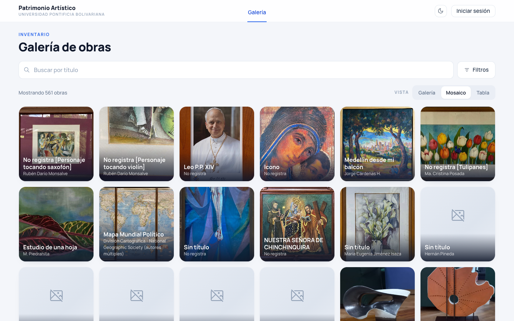
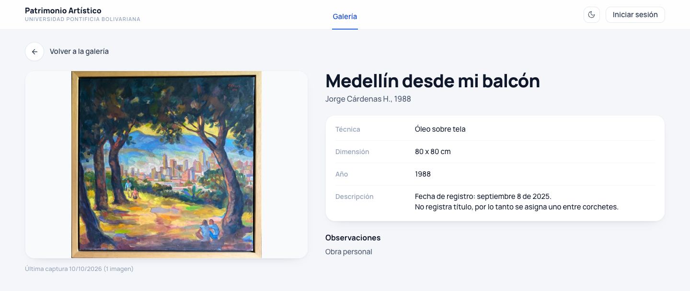
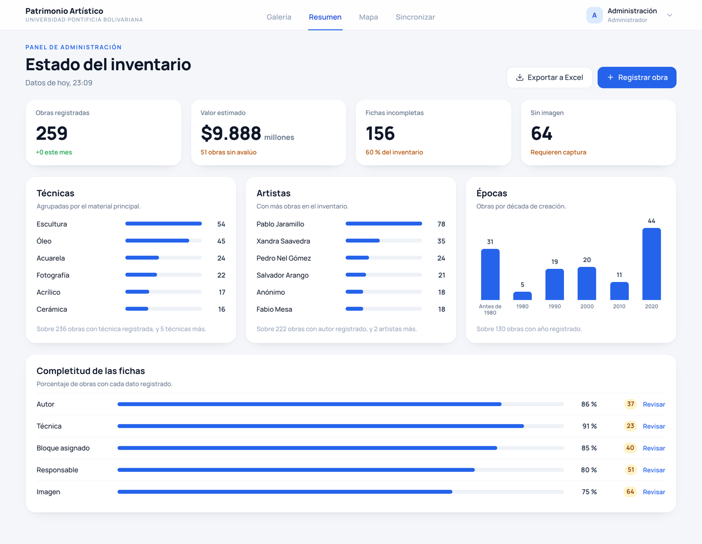
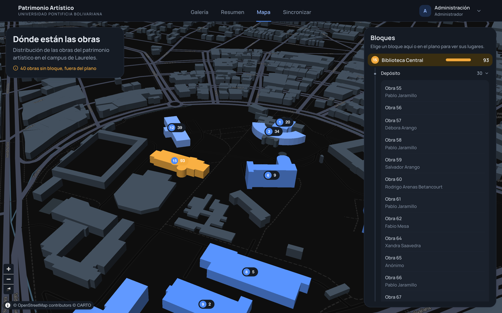
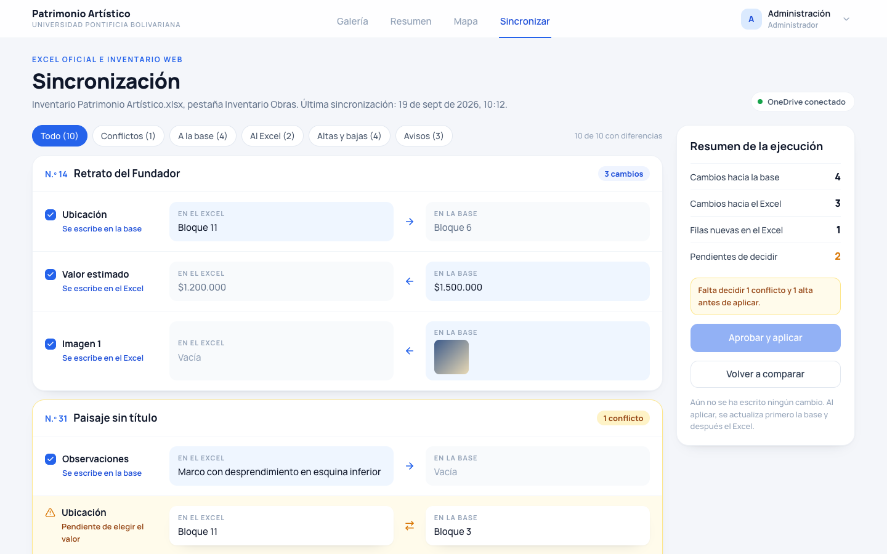

# Patrimonio Artístico UPB

**Inventario del patrimonio artístico de la Universidad Pontificia Bolivariana**

Catálogo público de obras, panel de administración y sincronización con el Excel oficial

[Sitio web](https://inventario-patrimonio-artistico-upb.netlify.app/) · [Descripción](#descripción)

 

Galería: el catálogo público, con búsqueda por título, filtros y tres vistas (Galería, Mosaico y Tabla).

---

## Descripción

Patrimonio Artístico UPB es la aplicación web con la que la universidad cataloga su colección de obras de arte. Cualquier visitante puede consultar el catálogo; las cuentas institucionales con rol de administrador gestionan el inventario completo.

| Pantalla | Funcionalidad |
|---|---|
| **Galería** | Consultar el catálogo, buscar por título y filtrar por autor o técnica (y, para administradores, por ubicación y responsable). |
| **Ficha de obra** | Ver los datos de una obra y sus imágenes, y editarla o eliminarla (administradores). |
| **Resumen** | Conocer el estado del inventario: valor estimado, composición de la colección y fichas incompletas. |
| **Mapa** | Ubicar las obras por bloque y por lugar en el campus de Laureles. |
| **Sincronización** | Comparar el Excel oficial con el inventario web, revisar las diferencias y aplicarlas en las dos copias. |

La ubicación, el valor, el bloque asignado y el responsable de cada obra son datos restringidos que solo ven los administradores. El inicio de sesión es exclusivamente con la cuenta institucional de Microsoft.

  
   Ficha de obra: datos públicos de la obra y visor de imágenes.

  
   Resumen: cifras del inventario y completitud de las fichas; "Revisar" abre la galería con las obras a las que les falta ese dato.

  
   Mapa: cada bloque del campus con su número de obras; al elegirlo se despliegan sus lugares y las obras de cada uno.

  
   Sincronización: cada diferencia enfrenta el valor del Excel y el de la base; nada se escribe hasta aprobar la revisión.

> [!NOTE]
> Las capturas de Resumen, Mapa y Sincronización usan datos de ejemplo.

La sincronización también funciona como complemento de Excel (`/complemento`), que trabaja sobre el libro abierto con los permisos de edición de quien lo usa.

 
Construido con Angular, Supabase y MapLibre. Mapas: © OpenStreetMap contributors, © CARTO

